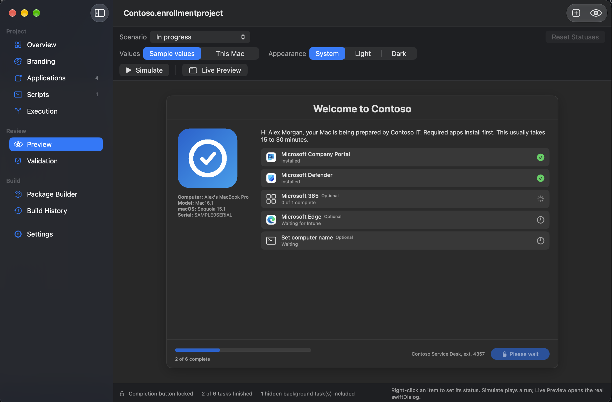
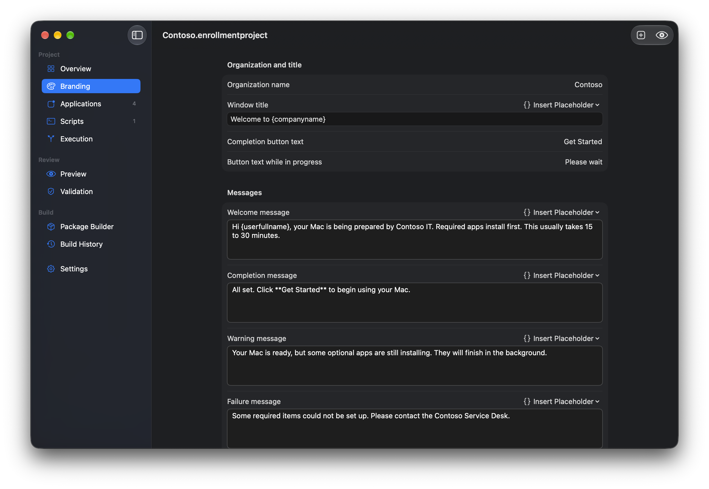
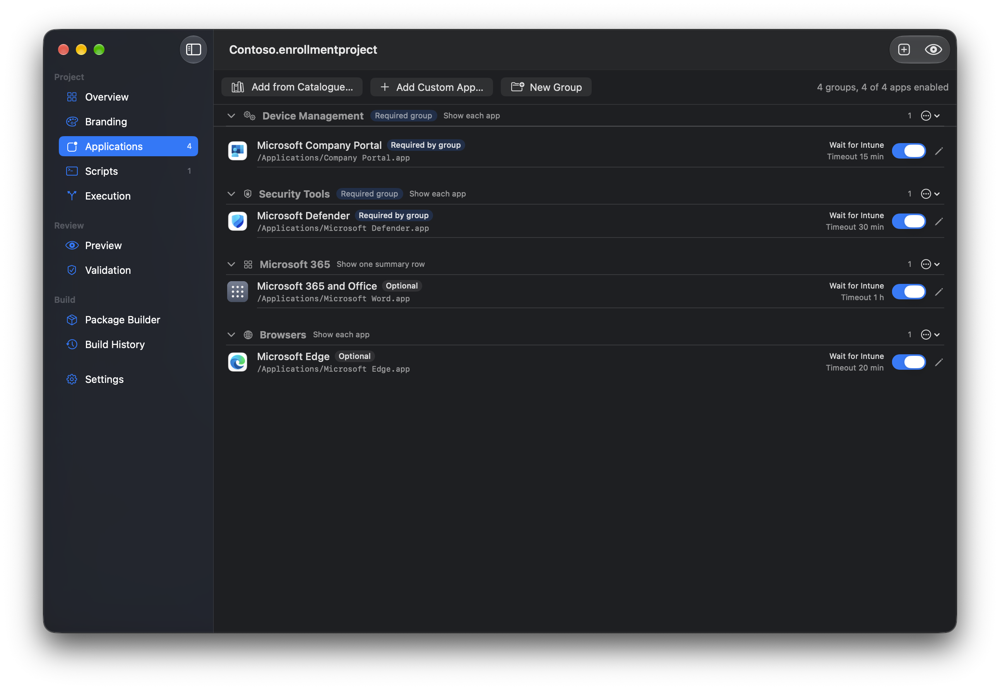
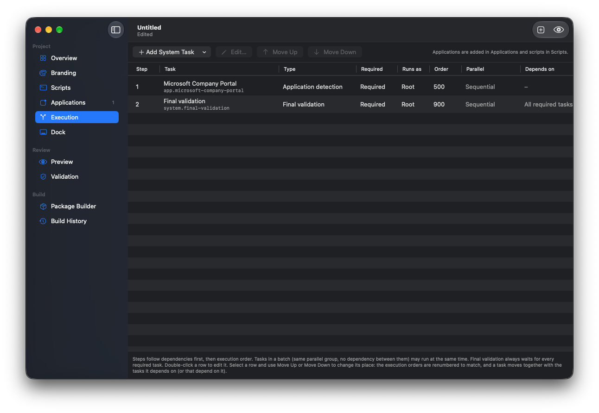
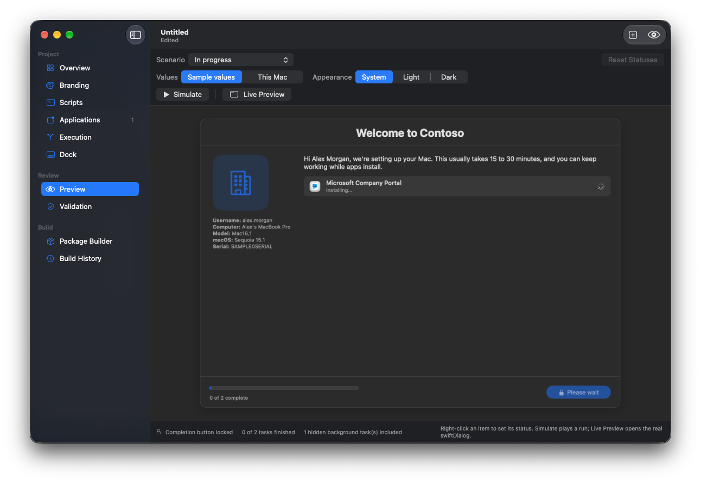
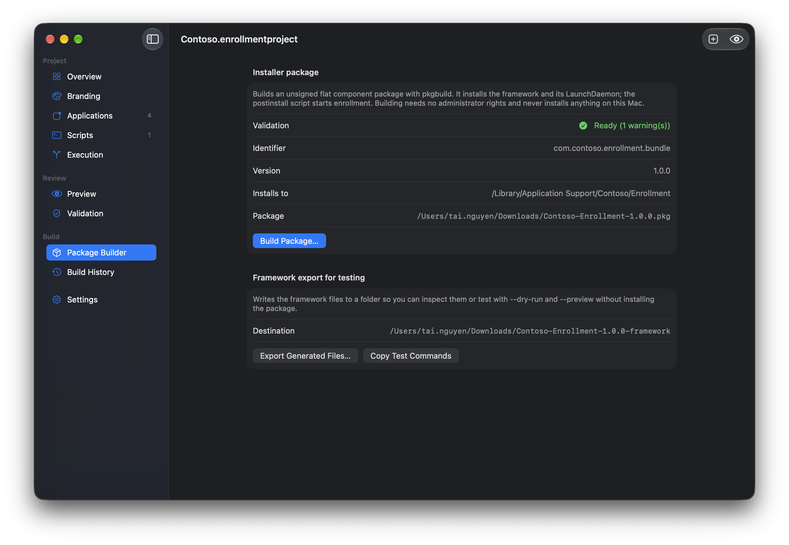

# Enrollment Bundle Studio

A native macOS app for designing swiftDialog-based enrollment experiences for Microsoft Intune. Design the splash screen, choose the apps and scripts, preview and validate it, then build the installer package. Everything runs locally: no server, no account, no Homebrew, Python or Node.js.


*The enrollment splash screen the app generates, played back with Preview > Simulate. Nothing is installed or executed.*

Step by step: **[How to use the tool](docs/HOW_TO_USE.md)**.

## What it does

- **Design** the dialog: title, welcome text, logo, banner, accent colour, placeholders such as `{username}` and `{serialnumber}`.
- **Choose** applications from a built-in catalogue or add your own, grouped and ordered.
- **Add** local shell scripts, with checks for Bash 3.2 compatibility and common risks. Scripts are never run by the app.
- **Control** execution order, parallel groups, dependencies and when the Done button unlocks.
- **Preview** the dialog natively, or with the real swiftDialog, using simulated task states.
- **Validate** the project, then build and verify an unsigned flat `.pkg` with a build report.
- **Upload** the package to Microsoft Intune from the app (optional), signing in with your default browser using your own Entra app registration.

## Screenshots

| Overview | Branding |
|---|---|
|  |  |

| Applications | Execution order |
|---|---|
|  |  |

| Preview, success | Preview, warning (dark mode) |
|---|---|
|  |  |


This repository contains **Phases 1 to 4** (complete): the app shell, project documents, Branding and Applications editors, the application catalogue and static preview, plus script import and inspection, execution order and dependencies, the validation engine, configuration export and import, schema migration, the generated Bash 3.2 enrollment framework with export, simulation and live swiftDialog preview, and unsigned flat package builds with verification, reports and history. See `docs/ARCHITECTURE.md`, `docs/SCRIPTS_VALIDATION_AND_TRANSFER.md`, `docs/FRAMEWORK.md` and `docs/PACKAGING_AND_DEPLOYMENT.md`.

## Requirements

- macOS 13 Ventura or later to run the app.
- Xcode 16 or later to build (the project uses file-system-synchronized folders).
- No third-party dependencies.

## Download

Get the latest build from the [Releases page](https://github.com/CMYK4NO/Enrollment-Bundle-Intune/releases). It needs macOS 13 or later.

1. Download the zip and unzip it.
2. Move **Enrollment Bundle Studio.app** to Applications.
3. On first launch, Control-click the app and choose **Open**. If macOS still refuses, open **System Settings > Privacy & Security** and choose **Open Anyway**.

The release is not notarized, so macOS asks for this confirmation once. The app does not remove the quarantine flag or change any security setting for you. If you prefer not to run an unsigned build, build it from source below.

## Build and run

1. Open `EnrollmentBundleStudio.xcodeproj` in Xcode.
2. Select the **EnrollmentBundleStudio** scheme and **My Mac**.
3. Press Run (⌘R). Debug builds are signed to run locally; no developer team is required.

From Terminal:

```bash
xcodebuild -project EnrollmentBundleStudio.xcodeproj -scheme EnrollmentBundleStudio -configuration Debug build
```

## Test

Press ⌘U in Xcode, or:

```bash
xcodebuild -project EnrollmentBundleStudio.xcodeproj -scheme EnrollmentBundleStudio -destination 'platform=macOS' test
```

Tests cover script inspection and import, hashing, dependency ordering and cycle detection, the validation engine, migration with backups, configuration export and import (tampering and path traversal included), the command runner allowlist and ShellCheck parsing with a mock runner, project encoding and decoding, schema version handling, the package-directory document (in memory and on disk in a temporary folder), placeholder replacement, reverse-DNS and version validation, filename sanitising, path traversal prevention, image import checks, catalogue integrity, editing operations, completion-button unlock rules, status aggregation and preview state. They never build packages, run scripts, install software or need administrator rights.

## Try it

- **File > New** creates a project with Company Portal in a required group and a hidden final validation task.
- **File > Open** `SampleProjects/Contoso.ebsproject` for a fuller example with a summary group, a hidden app, a logo and a script.
- **Scripts** imports `.sh` and `.zsh` files and shows checks, an optional ShellCheck run and a read-only preview. Scripts are never executed by the app.
- **Execution** shows the resolved run order. Double-click a task to edit order, parallel group and dependencies.
- **Validation** lists errors, warnings and information; errors will block exporting and building.
- **File > Export Configuration / Import Configuration / Duplicate as New Project** move projects between Macs and administrators.
- **Preview > Simulate** plays a timed run; **Live Preview** opens the real swiftDialog (if installed) and mirrors the preview. Nothing is executed.
- **Package Builder > Build Package** builds and verifies the unsigned flat installer package and writes a build report; **Export Generated Files** and **Copy Test Commands** support testing without installing.
- **Build History** lists previous builds with their SHA-256 and reports.
- **Upload to Intune** (Package Builder, after a verified build) signs you in through your default browser and uploads the package as a macOS app (PKG). It needs your own Entra app registration and its IDs in **Settings > Microsoft Entra**; see [Microsoft Entra setup](#microsoft-entra-setup-optional).
- **Onboarding guard:** the framework writes `/Library/Logs/Microsoft/IntuneScripts/onBoarding/onboarding.flag` after success and skips Macs that already have it, and on a first run it skips Macs whose MDM enrollment is older than the enrollment window (default 20 hours). The generated Intune pre-install script (`intune/pre-install.sh` in the export, set automatically by Upload to Intune) goes one step further and stops Intune from installing the package at all on a Mac that already has the flag.
- **swiftDialog:** a normal enrollment run installs swiftDialog automatically (official GitHub release, signature verified) before showing the dialog; previews and `--dry-run` never install it.
- **Preview** shows the dialog. Switch scenarios, switch between sample values and this Mac, switch light and dark, and right-click any item to simulate a status. The completion button locks and unlocks according to the required tasks, including hidden ones.

Keyboard shortcuts: ⌘1 to ⌘0 switch sidebar sections; ⇧⌘A opens the catalogue; ⌥⌘E exports and ⌥⌘I imports a configuration.

## Microsoft Entra setup (optional)

Only **Upload to Intune** needs a Microsoft account. The app does not sign in at launch, and everything else works without it.

1. Create your own Entra app registration (single tenant, public client). The steps are in `docs/PACKAGING_AND_DEPLOYMENT.md`.
2. Open **Settings > Microsoft Entra** and enter the registration's **Tenant ID** and **Client ID** (both GUIDs).
3. Press **Upload to Intune**. The browser opens for the Microsoft sign-in the first time.

The IDs are identifiers, not secrets, and the app has no client secret. They are stored in this Mac's preferences, never in a project, an export or a package. Tokens are kept in memory only, so you sign in again after the app restarts.

## Project format

Projects are folders with the `.ebsproject` extension containing a readable `project.json` and plain image and script files. Configuration exports use `.ebsconfig`. Details are in `docs/PROJECT_FORMAT.md`.

## Before distributing your own build

See also `docs/PACKAGING_AND_DEPLOYMENT.md`.

1. Set your own identifiers. They ship as placeholders: the app is `com.example.enrollmentbundlestudio`, the test bundle `com.example.enrollmentbundlestudio.tests`, and the document types `com.example.enrollmentbundlestudio.project` and `.configuration` (in `Config/Info.plist`, `Document/UTType+EnrollmentProject.swift`, `Document/UTType+Configuration.swift`, `Services/ConfigurationArchive.swift` and the tests). Change them once, before your first release; changing the document type identifier later breaks file association for existing projects.
2. Set your Apple Developer team and sign Release builds with your **Developer ID Application** certificate. Release builds already enable Hardened Runtime.
3. Archive (Product > Archive), export with Developer ID, then notarize and staple:

   ```bash
   xcrun notarytool submit "Enrollment Bundle Studio.zip" --keychain-profile "notary" --wait
   xcrun stapler staple "Enrollment Bundle Studio.app"
   ```

   Store notarization credentials with `xcrun notarytool store-credentials`; never put them in the project.
4. Deliver the app to administrators' Macs, for example through Intune as a signed package.

The App Sandbox is intentionally disabled; the reasons and mitigations are in `docs/ARCHITECTURE.md`, section 5.

## App icon

The app icon is `EnrollmentBundleStudio/Assets.xcassets/AppIcon.appiconset` (a generic placeholder; replace the PNGs with your own artwork). The target setting `ASSETCATALOG_COMPILER_APPICON_NAME = AppIcon` selects it.

## Known limitations

- "Run custom script" for an application cannot link a script; the app is detected like Wait for Intune. Use a script task with a dependency instead.
- Packages are unsigned flat component packages by design. Confirm your Intune app type accepts them.
- Placeholder Insert appends to the end of a field because SwiftUI on macOS 13 does not expose the cursor position.
- A migrated project writes its backup on the next save.
- Installer packages are not included in configuration exports.

## License

Released under the MIT License. See [LICENSE](LICENSE).
